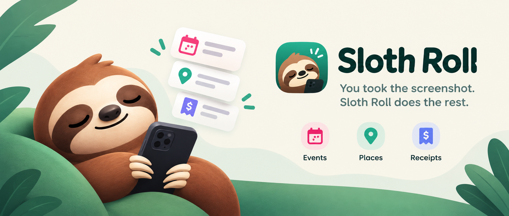
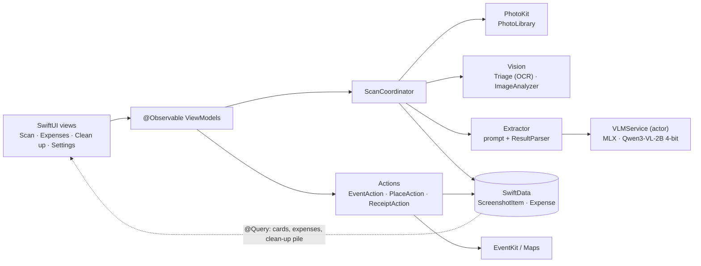

# Sloth Roll

**You took the screenshot. Sloth Roll does the rest.**

## Overview

An iPhone app that reads your screenshots with an open-weight vision model running on the
phone and turns each one into a card: an event for Calendar, a place for Maps, or a
receipt for your expense list. You only swipe. Nothing is uploaded, and after a one-time
model download it works in airplane mode.

Built for the "Slow and Steady" theme: your camera roll fills up with screenshots of
things you meant to do later. Sloth Roll does the slow, boring part for you, one image at a
time, on your phone, and waits. You don't type, copy, paste, or switch apps. You only
swipe, whenever you feel like it.

<!-- Replace with a GIF of a scan and a few swipes (e.g. public/sloth-roll-demo.gif). -->
_Demo GIF coming soon._ **Demo video:** _link coming soon_ <!-- paste the video link here -->

| The screenshot shows | Swipe right and… |
| --- | --- |
| An event (flyer, invite, ticket, chat with a date) | it's added to **Calendar** (add-only access) |
| A place (restaurant, venue, address) | it opens in **Apple Maps** |
| A receipt (purchase, bill, total) | it's saved to the in-app **Expenses** list, totals per currency |
| Nothing useful (memes, old chats, blurry or duplicate shots) | it lands in the **Clean up** pile, deleted in one tap through iOS's own confirmation |

## How it works

1. **Download once**: on first launch, three intro screens and a one-time download of the
   model (about 1.8 GB, Wi-Fi recommended).
2. **Scan**: pick what to read (all recent photos, or one album such as your Screenshots
   album), then tap Scan. The app looks at the newest images there and skips any it has
   already read. Keeping screenshots in one album lets you scan it, swipe, and clean it up. A cheap **triage** pass runs first with no model loaded: camera photos are
   skipped, and Apple's Vision text recognition must find at least 20 characters. The
   same pass measures blur and takes a Vision feature print for duplicates.
3. **Read**: the model loads once and reads only the images that passed, newest first.
   It answers with one JSON object (type, title, date, time, place, amount, currency,
   confidence). The prompt gives it the screenshot's own date, so "mañana" or "este
   sábado" land on the right day. Answers are untrusted: a forgiving parser checks every
   field, a bad answer gets one stricter retry, and it never crashes on bad output. Each
   answer is saved right away; the model is unloaded at the end.
4. **Swipe**: each action becomes a card. Right does it (Calendar, Maps, or Expenses),
   left skips it for good, and a tap lets you fix the title, date, place, or amount first.
   Cards the model wasn't sure about say "not sure".
5. **Clean up**: leftovers that are blurry, near-duplicates, or that the model calls not
   useful ("Is this screenshot still useful to keep?", only a clear "no" counts) show up
   in a Clean up tab. Delete goes through iOS's confirmation into Recently Deleted.

**Where your screenshots go.** Nowhere. Text recognition (Vision) and the model (MLX on the
phone's GPU) both run on the iPhone; no image, text, or result is uploaded, and there is no
account, analytics, or server. The only network call is the one-time model download.
After that, scanning, cards, Calendar, Expenses and Clean up all work in airplane mode.
Opening a place hands it to Apple Maps, which uses Apple's place search when there's a
connection. Calendar access is add-only: the app can't read your events.

Every step in detail: [docs/how-it-works.md](docs/how-it-works.md).

## Architecture



`ScanCoordinator` lists new images from PhotoKit, triages them with Vision, loads the model
once, has `Extractor` read what passed, saves each answer to SwiftData, judges leftovers
for clean up, then unloads the model. Views read SwiftData with `@Query`, so cards appear
while the scan runs. A swipe goes through a ViewModel to an `ActionPerformer`.
Dependencies point downward only (rules in [CLAUDE.md](CLAUDE.md)); every service is a
protocol wired in `AppDependencies`, so tests swap in fakes.

```
SlothRoll/         The app (SwiftUI, Swift 6, iOS 18+)
  App/             Entry point, AppDependencies (wires services), RootView, tabs
  Features/        One folder per screen: Onboarding, Scan, Expenses, Cleanup, Settings,
                   Debug (eval screen, Debug builds only)
  Pipeline/        ScanCoordinator, PhotoLibrary, Triage, Extractor, ExtractionPrompt,
                   ResultParser, clean-up judging
  Inference/       VLMService (actor), ModelCatalog (model ID and size in one place)
  Actions/         EventAction (EventKit), PlaceAction (Maps), ReceiptAction (expenses)
  Models/          Plain value types (ActionResult, ActionType, Confidence, ...)
  Storage/         SwiftData models (ScreenshotItem, Expense) and Persistence
  Shared/          Logger categories, toast, small extensions
  Resources/       Assets, Info.plist, entitlements
SlothRollTests/    102 unit tests, same folders as the app
docs/              How it works in detail, architecture, Xcode setup, debug tools and eval
public/            Banner and icon for this README
project.yml        XcodeGen spec (the generated SlothRoll.xcodeproj is committed)
```

Every folder, type and data flow: [docs/architecture.md](docs/architecture.md).

## Setup (quick start)

Needs Xcode 27.1+, a physical iPhone on iOS 18+ (tested on an iPhone 17 Pro; MLX doesn't
run in the Simulator), about 2 GB free on the phone, and an Apple ID in Xcode (a free
Personal Team works). No API keys, accounts, or servers.

1. Install the Metal Toolchain once (MLX compiles Metal shaders):
   `xcodebuild -downloadComponent MetalToolchain`
2. Open `SlothRoll.xcodeproj`. Swift packages resolve on their own (pinned in
   `Package.resolved`).
3. **Signing**: target `SlothRoll` › Signing & Capabilities › pick your own Team (the
   committed team is the author's). If the bundle ID is taken, change
   `com.martinespericueta.slothroll` to something unique.
4. On the iPhone, turn on Developer Mode, pick it as the destination, and Run. With a
   free team, trust the developer in Settings › General › VPN & Device Management.
5. First launch: stay on Wi-Fi for the model download. Allow **Full Access** to Photos on
   the first scan, and Calendars (add-only) on the first event swipe.
6. Tests: ⌘U with an iPhone Simulator selected (102 unit tests).

Version 1.0 (build 1). Step-by-step details and command-line builds:
[docs/xcode-setup.md](docs/xcode-setup.md). Eval screen, launch arguments and logs (Debug
builds only): [docs/debug-and-eval.md](docs/debug-and-eval.md).

## Screenshots

<!-- Replace with real screenshots (PNG in public/) before submitting. -->

| Onboarding | Swipe cards | Expenses | Clean up |
| --- | --- | --- | --- |
| _screenshot_ | _screenshot_ | _screenshot_ | _screenshot_ |

## Known limitations

- **Spanish and English only.** The prompt and the test set cover those two; weekday
  names and relative dates are spelled out only in them.
- **Accuracy** (eval screen, 19 hand-checked images, iPhone 17 Pro): type right on 18 of
  19 (95%), all 6 junk images came back "none"; the miss was a cinema purchase history read
  as an event instead of a receipt. Fields are weaker: date and time both right on 6 of 10
  events (slips: a chat timestamp or the status-bar clock taken as the event time, a
  past date with no year put in this year). Small set: a sanity check, not a benchmark.
  Every card can be edited before you swipe.
- **Speed**: about 4 to 8 seconds per image once the model is loaded; a 50-image scan takes
  a few minutes with the app open.
- Clean up thresholds (blur, duplicates) are educated guesses and err on keeping.
- The edit sheet can't change a card's type. Expenses stay in the app (no export).
  iPhone only, portrait only.

More numbers: [docs/debug-and-eval.md](docs/debug-and-eval.md#accuracy-and-limits).

## Models, libraries and licenses

| What | Used for | License |
| --- | --- | --- |
| [`mlx-community/Qwen3-VL-2B-Instruct-4bit`](https://huggingface.co/mlx-community/Qwen3-VL-2B-Instruct-4bit), a 4-bit MLX conversion of [`Qwen/Qwen3-VL-2B-Instruct`](https://huggingface.co/Qwen/Qwen3-VL-2B-Instruct) | Reading screenshots and the clean-up question (one model, ~1.8 GB on disk, ~2 GB in memory) | [Apache-2.0](https://www.apache.org/licenses/LICENSE-2.0) |
| [MLX Swift](https://github.com/ml-explore/mlx-swift) | Running the model on the iPhone's GPU (Metal) | MIT |
| [mlx-swift-lm](https://github.com/ml-explore/mlx-swift-lm) (`MLXVLM`, `MLXLMCommon`) | Loading and running vision-language models | MIT |
| [swift-transformers](https://github.com/huggingface/swift-transformers) | Tokenizer | Apache-2.0 |
| [swift-huggingface](https://github.com/huggingface/swift-huggingface) | The one-time model download | Apache-2.0 |
| Apple PhotoKit, Vision, EventKit, MapKit, SwiftData, SwiftUI | Photos, text recognition, feature prints, Calendar, Maps, storage, UI | Apple SDK |

The model ID lives in one place: `SlothRoll/Inference/ModelCatalog.swift`.

The code in this repo is under the [MIT License](LICENSE). Models and libraries keep their
own licenses above.

## Credits

- Qwen3-VL by the Qwen team (Alibaba Cloud); 4-bit MLX conversion by mlx-community.
- MLX and mlx-swift-lm by Apple's ml-explore team; swift-transformers and
  swift-huggingface by Hugging Face.
- Built by Martin Espericueta.
